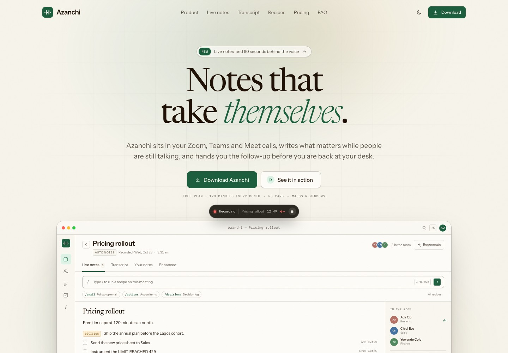
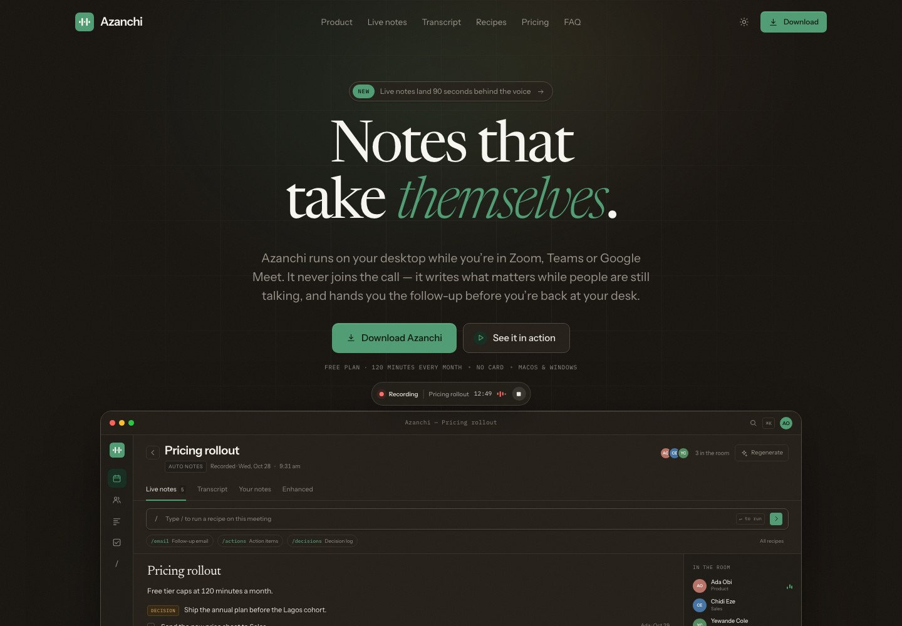
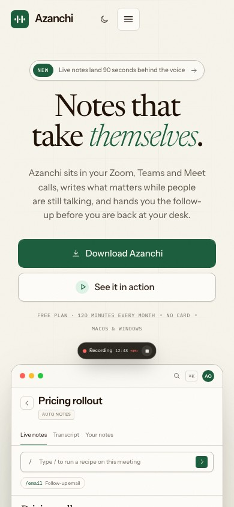

# Azanchi — landing page

A marketing page for **Azanchi**, the AI meeting assistant for Nigeria, Ghana and Kenya. It is
built around the same truth as the product: the note should be written while people are still
talking, and the follow-up should be ready before the meeting ends.

The information architecture borrows Linear's discipline — sticky product nav, a product-led hero,
a dark feature band, a single pricing decision, a short FAQ and one closing action — while the visual
language stays Azanchi's own **Warm Ledger**: paper-warm neutrals, one deep forest green, crimson
only ever for recording.

## Run it

```bash
npm install
npm run dev        # http://localhost:5173
npm run build      # typecheck + production build
npm run preview    # serve the build on :4173
```

Stack: Vite 8 · React 19 · TypeScript · hand-written CSS (no UI framework). Fonts are self-hosted
(Newsreader, Instrument Sans, IBM Plex Mono), so the page has no runtime font dependency.

## Screens

Light and dark are the same design, not a filter — the palette, elevation and the deep-green
closing panel are resolved per theme.







More: [live notes](preview/live-notes.jpg) · [pricing](preview/pricing.jpg) · [download](preview/download.jpg)

## Structure

```
src/
  App.tsx                 page composition
  components/
    Nav.tsx               sticky nav, mobile sheet, theme toggle
    Hero.tsx              hero copy + app window + integration strip
    ProductWindow.tsx     the in-app meeting note (HTML, not a screenshot)
    HowItWorks.tsx        sign-in → record → leave, with three small states
    LiveNotesSection.tsx  dark band; notes arrive progressively on scroll
    TranscriptSection.tsx searchable, speaker-attributed transcript
    RecipesSection.tsx    interactive `/` recipe switcher + copyable output
    TrustSection.tsx      consent, no-bot, managed data, export, local rails
    QuoteSection.tsx      "Calm is the feature." + three principles
    PricingSection.tsx    monthly/annual Free/Pro/Business
    FaqSection.tsx        accordion, real product answers
    DownloadSection.tsx   closing CTA with direct macOS / Windows downloads
    Footer.tsx
  hooks/useSite.ts        theme, scroll state, reveal observer, reduced motion
  styles/
    tokens.css            Warm Ledger tokens, copied from mitra-app
    base.css              reset, type, buttons, reveal, grain
    landing.css           page-level layout and marketing sections
    demos.css             app window, recording chip, live notes, transcript, recipes
    responsive.css        1180 / 1024 / 980 / 860 / 760 / 620 / 480
```

## Product facts encoded here

Sourced from the Azanchi app repo (`mitra-app`: `CONTEXT.md`, `src/locales/en.json`,
`src/screens/pricing/PricingView.tsx`, the design brief and ADRs):

- **Free** — 120 minutes/month; live notes, speaker-attributed transcript, one summary per meeting.
- **Pro** — ₦16,500/month or ₦181,500/year; 1,200 minutes; action items, follow-up email,
  unlimited enhanced rewrites.
- **Business** — ₦28,500/seat/month or ₦313,500/seat/year; 1,500 minutes per user, pooled;
  shared workspace, seats, invoiced billing.
- Paystack, with card / mobile money / bank transfer; ₦, GH₵ and KSh.
- Google sign-in is live; Microsoft work accounts are described as coming (the app currently
  disables Microsoft sign-in).
- Recording is **never invisible**: the crimson chip is always on screen. Azanchi captures system
  audio from the machine — no bot joins the call.
- Transcription is managed (no local model, no API key); audio is never used to train models.
- Transcription languages are English (Global), Kiswahili and Français, per the Soniox decision.

## Downloads

The page no longer captures an email — every download CTA goes to the download panel and the panel
links straight at the installers. The three expected files are:

```
public/downloads/Azanchi-0.1.0-macos-arm64.dmg
public/downloads/Azanchi-0.1.0-macos-x64.dmg
public/downloads/Azanchi-0.1.0-windows-x64.exe
```

Drop the signed builds there, or point the page at your CDN / GitHub Releases in `.env`:

```bash
VITE_DOWNLOAD_BASE_URL=/downloads
# or override individual files:
VITE_DOWNLOAD_MAC_ARM64=https://downloads.example.com/Azanchi-0.1.0-macos-arm64.dmg
VITE_DOWNLOAD_MAC_INTEL=https://downloads.example.com/Azanchi-0.1.0-macos-x64.dmg
VITE_DOWNLOAD_WINDOWS=https://downloads.example.com/Azanchi-0.1.0-windows-x64.exe
VITE_APP_VERSION=0.1.0
```

`src/data/downloads.ts` is the single source of truth. The page detects macOS vs Windows and puts
the matching build first; macOS visitors get both Apple silicon and Intel choices. Large installer
files should normally live on a CDN/release host rather than in this repository.

Installers are not checked into this repository. Add them under `public/downloads/` or point the
links at your release host before launch; sign-in happens inside the desktop app.

## Before shipping

- Add the signed/notarised macOS builds and the Windows installer (or set the env URLs above).
- Make sure `src/data/contact.ts` points at an inbox that actually exists on a domain we own
  (`hello@azanchi.com` today). There is no contact form, so a dead inbox is a dead contact path.
- The legal pages are static HTML at `public/privacy.html` and `public/terms.html`, not React routes, so
  they keep working for verification crawlers and every static host; nginx here has no
  directory-index handling, so the flat `.html` URLs are deliberate. They are generated from the signed Word documents;
  re-check them when counsel revises those documents.
- Confirm the pricing and claim copy with the product team, including the GH₵/KSh display
  rates in `src/data/currency.ts` (they are conversions, not list prices).
- Add analytics consent if you run PostHog.
- Share cards use `public/og.png` (1200×630; source `preview/og-card.html`). Regenerate it if the
  promise line changes, and keep the `og:image` URL absolute.

## Accessibility & performance

- Semantic landmarks, one `h1`, labelled sections, real buttons and links.
- The mobile sheet is inert and out of the accessibility tree while closed; opening it locks
  page scroll. Escape closes it.
- Visible focus rings, 44px primary controls, reduced-motion support, no horizontal overflow from
  320 to 2560 (verified).
- Theme follows the OS on first visit and persists locally; `?theme=light|dark` is available for
  screenshots and QA.
- The app window is built in HTML/CSS (no image payload); the hero uses a single 1120px frame with
  scroll-triggered live-note animation.
